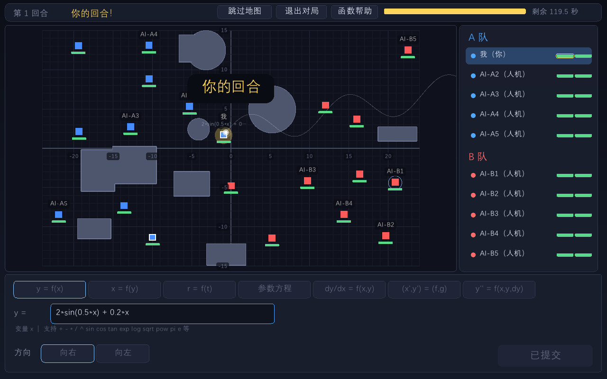
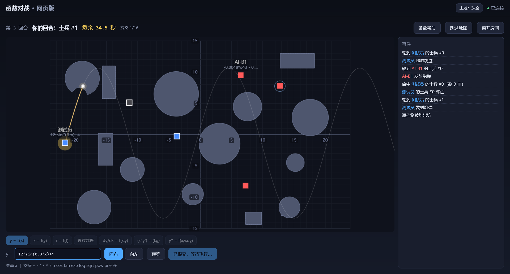
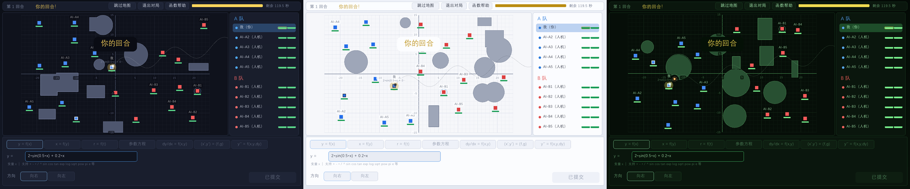
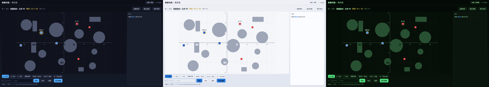

# 函数对战（Function Battle）

[](https://github.com/yunsmall/function-battle/actions/workflows/ci.yml)
**English**: [README.en.md](README.en.md)



直角坐标系上的回合制数学射击游戏：两队玩家轮流在限时内输入一个函数（或曲线方程），
炮弹就沿该曲线从你的位置飞出——穿透、友伤、撞上遮挡物会炸出坑。一队全灭则另一队获胜。
玩法概念源自 [Graphwar](https://github.com/catabriga/graphwar)（在坐标系上输入函数、
炮弹沿曲线飞的回合制射击）；本项目完全独立重写，并加入了权威服务器、多人联机与
网页版。

- **C++ 权威服务器**：asio TCP（原生客户端）+ WebSocket（网页客户端）双协议同进程，
  多房间、60Hz 权威模拟，人机在服务器线程池里思考
- **raylib 图形客户端**：单机人机（内置本地服务器逻辑）+ 联机对战 + 观战
- **网页客户端**：浏览器打开即玩（不需要任何额外进程）；网页玩家与 C++ 玩家在同一个
  房间里混战（同一套 JSON 协议，一个 WS 文本帧 = 一条消息）
- 核心逻辑（曲线、世界、AI、房间、协议）是服务器与客户端共用的静态库，两端行为一致

## 玩法规则

**曲线定位规则（核心）**：曲线整体平移，使图像参数起点落到你的发射位置——函数里的
常数项对轨迹没有影响。例：你在 (2,10) 输入 `cos(x)`，实际轨迹是 `y = cos(x−2) + 9`。

七种曲线模式：

| 模式 | 形式 | 参数范围默认 | 方向 |
|---|---|---|---|
| y = f(x) | 一元函数 | 按地图范围 | 向右（默认）/ 向左 |
| x = f(y) | 一元函数 | 按地图范围 | 向上（默认）/ 向下 |
| r = f(θ) | 极坐标 | 0 → 2π | 参数递增方向 |
| 参数方程 | (x(t), y(t)) | 0 → 1000 | 参数递增方向 |
| dy/dx = f(x,y) | 微分方程（RK4 积分） | — | 沿 +x（默认）/ 沿 −x |
| (x', y') = (f, g) | 微分方程组（RK4 积分） | t 从 0 起 | 参数递增方向 |
| y'' = f(x, y, dy) | 二阶微分方程（RK4 积分） | — | 发射角可调（±85°） |

参数方程不限制参数 t 的取值；曲线实际长度只受"行进距离 ≤ 地图斜对角线 × 2"一个
约束（写 `(t, t)` 会一路画到出地图或走满该长度为止）。曲线可以短暂越出地图边界
（留给"飞出去再绕回来"的弹道）：采样在边界外 8 单位处截断。

**回合**：输入阶段（限时，默认 120 秒）→ 提交 → 飞行阶段（炮弹消失前进下一轮）。
炮弹从你的位置沿曲线按弧长匀速运动（默认 12 单位/秒）；命中士兵扣血（默认 1 血 =
一击毙命），同一发炮弹对同一士兵只结算一次，**友伤开启**；撞上遮挡物会被销毁，并在
爆炸点附近所有相交的遮挡物上炸出坑（坑内不再阻挡后续炮弹）。**飞出地图边界后有
3 秒的"绕回来"宽限**：高抛越顶、大弧线从侧面兜回这类弹道不会一出界就被销毁，连续
出界满 3 秒仍未回界内才销毁；超程同样销毁。

**地图**：默认 48×30（x∈[−24,24], y∈[−15,15]），遮挡物（圆形/方形）与出生点由种子
决定，同种子完全复现。

**表达式**：允许的数学函数/常量在帮助面板里列出；字符白名单 + 禁用控制流（要"纯数学"）。

**人机**：四档难度（简单/普通/困难/大神）。低难度带瞄准误差、形状随机；困难/大神做
多目标插值规划（一发穿多人 + 模仿"再调调系数"的微调），并且**优先选全程不碰障碍的
曲线**——只有确实找不到干净解时才炸障碍开路。

**房间密码**（可选）：创建房间时可设密码。密码在本地客户端算 SHA-256（传输中不出现
明文），服务器只存/比对哈希、绝不下发，房间列表只显示"有密码"标记。

## 架构

```
fb_server（单进程，双端口共享同一个房间表）
  9527  原生协议：长度前缀 + JSON 帧（C++ 客户端）
  8000  WebSocket 文本帧 + 静态文件（网页客户端；同源、同一套消息）
```

- 权威模拟：所有物理/命中/地形变化都在服务器算；客户端用本地重采样出的同一条曲线
  做平滑渲染，不上传推演结果
- 炮弹位置约 20Hz 广播，客户端用"外推目标 + 平滑收敛"逐帧插值（无瞬移，炮弹销毁即停）
- 观战随时可进（对局中给快照），与在局玩家共享同一广播流
- 服务器 tick 60Hz；人机决策在线程池上跑，不阻塞 io

## 构建

依赖用 [vcpkg](https://github.com/microsoft/vcpkg) 管理（`<vcpkg>` 指你的 vcpkg
目录）：

```bash
git clone https://github.com/microsoft/vcpkg <vcpkg>   # 已装过 vcpkg 可跳过
<vcpkg>/bootstrap-vcpkg       # Windows 为 bootstrap-vcpkg.bat，Linux/macOS 为 .sh
<vcpkg>/vcpkg install eigen3 nlohmann-json asio cxxopts exprtk gtest
```

websocketpp（0.8.2）与 raylib 5.5 官方预编译包都不进仓库——配置时 CMake 自动下载
并校验 SHA-256（websocketpp 与项目统一用 standalone asio；raylib 不用 vcpkg 的
6.0，因其存在呈现回归）。然后配置构建（clang + Ninja 示例，换其他编译器/生成器
同理）：

```bash
cmake -B build -GNinja \
  -DCMAKE_TOOLCHAIN_FILE=<vcpkg>/scripts/buildsystems/vcpkg.cmake \
  -DCMAKE_CXX_COMPILER=clang++
cmake --build build            # 或 ninja -C build
```

Linux 上不需要图形客户端（raylib 预编译包仅 Windows），加 `-DFG_BUILD_CLIENT=OFF`
只构建核心、服务器与测试。

产物：`build/src/server/fb_server.exe`、`build/src/client/fb_client.exe`、
`build/src/tests/fb_tests.exe`、`build/src/tools/fb_play.exe`。

### 打包发布（zip）

```bash
cmake --install build --prefix dist   # 装到一个扁平目录（解压即用的布局）
cd build && cpack -G ZIP              # 或直接打出 function_battle-<版本>-<系统>.zip
```

发布包为扁平布局：exe、raylib.dll、MSVC 运行库、`web/` 静态页在同一层——服务器按
exe 所在目录定位网页文件，解压后从任何位置启动都能直接运行。

## 运行

**从发布 zip 玩乐**：解压后在解压出的目录里运行——Windows 双击 `fb_client.exe`
（单机人机）或 `fb_server.exe`（开服，浏览器打开 `http://<本机>:8000/`）；包内已
附带全部运行库，没有其他安装步骤。

### 服务器

```bash
fb_server                            # 默认：游戏端口 9527 + 网页端口 8000
fb_server --port 9527 --web-port 8000 --seed 12345 --hp 3 --input-seconds 60
fb_server --web-port 0               # 关掉网页端口（只留原生协议）
fb_server --selftest 50              # 不开网络：本地跑 50 局 AI 对战自检
```

命令行选项同时是"创建房间"的默认配置（客户端可在房间内覆盖）。

### C++ 客户端

```bash
fb_client                            # 图形界面：主菜单 → 单机人机 / 联机对战
fb_client --selftest 10              # 无头：本地人机跑 10 局
fb_client --screenshot shot          # 自动对局并截图（shot_input.png 等，开发验证用）
fb_client --theme 1                  # 启动主题：0 深空 / 1 明亮 / 2 终端绿
```

主菜单的"主题"按钮可随时循环切换三套配色（见下方"配色主题"）。

**单机人机**：设置页可选每队人数、每人士兵数、人机难度、血量、遮挡物、先手、
输入时限；还可以选"对局身份 → 观战"，只看人机互打（你不进阵容）。

**联机**：主菜单 → 联机对战 → 填服务器地址 → 连接。大厅里可创建/加入房间（带密码的
房间需在"加入密码"框里填）；房间准备界面里房主可调整阵容（加人机、换队、踢人）与
"下一把配置"，之后开始游戏。

### 网页版

服务器跑起来后，浏览器直接打开 `http://<服务器地址>:8000/` 即玩。网页玩家与 C++
玩家（含手机浏览器）连的是同一个房间表，可以同房对战或同队混编。顶栏的"主题"按钮
切换配色（记忆在浏览器本地）。



**观战**：参战者与观战者是两类成员：

- 大厅房间列表里"参战"与"观战"分列两个人数；**观战**按钮随时可进——包括对局进行中
  （会收到当前局面快照，从当前回合接着看）
- 在房间准备界面，任何人都可以把自己"转为观战"（对局进行中不行：阵容锁定）；
  观战者没有队伍、占独立名额（20 席）、不能提交曲线，但会出现在成员列表里
- 对局进行中：参战者阵容锁定（不能进、不能走、不能换队），观战者随时可以进出；
  观战者的对局界面没有自己的玩家标记、操作面板禁用，顶栏有"退出观战"
- 纯 AI 观战：房主转为观战 + 两队都加人机，开局后就是一场 AI 对 AI，房主全程旁观

### 配色主题

三套预设配色：**深空**（默认）、**明亮**（白天/投影环境）、**终端绿**（复古终端风）。
语义色跨主题保持稳定——A 队永远蓝、B 队永远红、金/危险/成功色各自可辨——换主题只调
底色、面板与战场基础层。C++ 客户端在主菜单切换（也可 `--theme N` 指定启动主题），
网页版在顶栏切换；两端的主题同名同性格。





## 测试

```bash
fb_tests                             # gtest 单元测试（曲线/世界/AI/房间/协议/哈希……）
fb_server --selftest 100             # 整局自检 + 同种子复现性检查
fb_client --selftest 100             # 客户端无头整局
```

## 目录结构

```
src/core/     共享核心：config 配置、expr 表达式封装、curve 曲线采样、world 世界模拟、
              ai 人机、room 房间（成员/开局/AI 驱动）、protocol 协议编解码、
              sha256（房间密码哈希）、error 错误结构
src/server/   net（asio TCP/WS 帧协议）、server（多房间、60Hz tick 分发）、
              web_front（网页接入：WS + 静态文件）、main
src/client/   app（应用状态机）、ui_*（各界面）、render、net_client、headless（无头测试/截图）
src/tests/    gtest 单元测试
web/static/   网页客户端（原生 JS、无构建步骤）：app.js / render.js / net.js / path.js /
              sha256.js / strings.js / sfx.js
docs/         截图（README 用）
src/tools/    fb_play：文件信箱式的对局客户端（往文件里写表达式即提交，供脚本/AI 助手玩）
```

协议与错误码表见 [PROTOCOL.md](PROTOCOL.md)。

## 许可

本项目以 **GPL-3.0** 许可开源（全文见 [LICENSE](LICENSE)）。

第三方依赖的许可：Eigen3（MPL-2.0）、nlohmann-json（MIT）、asio（Boost Software
License）、cxxopts（MIT）、websocketpp（BSD-3-Clause）、gtest（BSD-3-Clause）、
raylib 5.5（zlib）、exprtk（MIT，其头文件内注明；
老版 exprtk 曾为非商业许可，本仓库锁定的是 MIT 版）。
